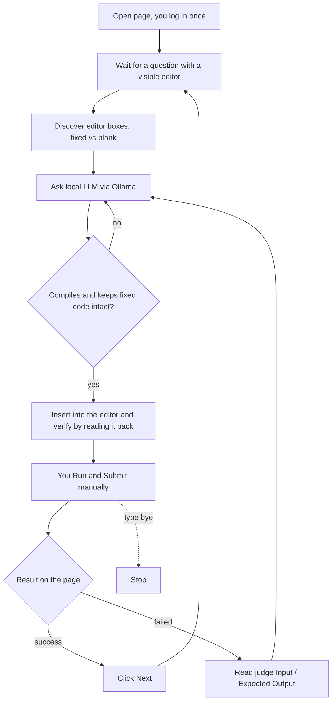

# Skill_Plotform_Automation_system
# Skill Assist

**A local, human-in-the-loop AI assistant for browser-based coding practice platforms.**

It opens a practice question in your browser, drafts a solution with a **local LLM (Ollama)**, fills it
into the code editor, waits while **you** run and submit, learns from the judge's feedback if the run
fails, and then moves to the next question. It keeps going until you type `bye`.

> **Responsible use:** this project is meant for practice and learning. See
> [Responsible use](#responsible-use) before running it on any platform.

---

## Table of contents

- [Features](#features)
- [How it works](#how-it-works)
- [Supported editor layouts](#supported-editor-layouts)
- [Requirements](#requirements)
- [Installation](#installation)
- [Configuration](#configuration)
- [Usage](#usage)
- [Terminal commands](#terminal-commands)
- [Project structure](#project-structure)
- [Troubleshooting](#troubleshooting)
- [Testing](#testing)
- [Limitations](#limitations)
- [Responsible use](#responsible-use)

---

## Features

- **Fully local AI.** Uses an [Ollama](https://ollama.com) model on your own machine. No API keys and no
  code or questions leave your computer.
- **Continuous loop.** Question after question until you say `bye`; the model stays loaded in memory
  between questions so later ones start fast.
- **Automatic editor filling with verification.** The code is inserted into the page and read back to
  confirm it landed. Falls back to keyboard typing if the editor has no usable API.
- **Template and fill-in-the-blank aware.** Handles questions where part of the code is locked:
  - a single editor with fixed lines and one incomplete line (`N =`),
  - several boxes: read-only fragments with editable blanks between them,
  - and strips fixed code the model wrongly repeats (e.g. a second `#include` / `main`).
- **Learns from failures.** When the page reports a failed run, the judge's *Input / Expected Output* is
  sent back to the model together with its previous answer, and the fix is inserted automatically
  (up to `MAX_RETRIES` times).
- **Compile / syntax check before insertion.** The fixed code and your blanks are assembled into the
  full program and checked (Python always; C/C++ if `gcc` / `g++` is installed). A broken draft is
  regenerated with the compiler error.
- **Auto-navigation.** Clicks the site's *Next* button after a successful submit (auto-detected by its
  label, or set `NEXT_SELECTOR`).
- **Visible and safe.** The boxes it will fill are outlined in green, every draft is saved to
  `generated/`, and **you always press Run / Submit yourself**.
- **Self-diagnosing.** If it cannot find the editor it writes `diagnose_report.txt` describing every
  input-like element on the page, so selectors are easy to fix.
- **Persistent login.** A dedicated browser profile keeps you logged in between runs.

## How it works



## Supported editor layouts

| Layout | Example | How it is handled |
| --- | --- | --- |
| One free editor | Write the whole program | Insert the whole solution |
| One editor with a template | Fixed lines plus an incomplete line such as `N =` | Fixed lines are kept; only the changed lines are edited |
| Several boxes | Read-only `numList =`, a blank, read-only `print(`, a blank, read-only `)` | Only the blanks are filled |
| Fixed head and tail around one blank | `#include` / `main() {` above, `return 0; }` below | Only the statements for the middle box are inserted |

Supported editor types: **Ace, CodeMirror 5, CodeMirror 6 (best effort), Monaco, plain `<textarea>` /
`<input>`, and `contenteditable`**, in the main page or inside iframes. The language is read from the
editor mode, then the language dropdown (e.g. `Python3 (3.12)`), then the page text. Python, C, C++, Java
and SQL are supported.

## Requirements

- Python 3.10 or newer
- [Ollama](https://ollama.com) running locally with a code model (default `qwen2.5-coder:7b`)
- Chromium, installed through Playwright (see below)
- Optional: `gcc` / `g++` on your `PATH` for the C/C++ compile check

## Installation

```bash
git clone https://github.com/<your-username>/<your-repo>.git
cd <your-repo>

python -m venv .venv
# Windows (PowerShell):  .venv\Scripts\activate
# macOS / Linux:         source .venv/bin/activate

pip install -r requirements.txt
playwright install chromium

ollama pull qwen2.5-coder:7b
```

Create your settings file:

```bash
cp .env.example .env        # Windows: copy .env.example .env
```

Then edit `.env` and set at least `TARGET_URL`. **Never commit `.env`**; it is already in `.gitignore`.

## Configuration

All settings live in `.env` (or can be set as environment variables). `--url` and `--model` on the
command line override `TARGET_URL` and `OLLAMA_MODEL`.

| Variable | Default | Description |
| --- | --- | --- |
| `TARGET_URL` | *(required)* | Page to open (a question page or your dashboard) |
| `OLLAMA_URL` | `http://localhost:11434` | Ollama server address |
| `OLLAMA_MODEL` | `qwen2.5-coder:7b` | Model used to draft solutions |
| `OLLAMA_KEEP_ALIVE` | `60m` | How long Ollama keeps the model loaded |
| `REQUEST_TIMEOUT` | `180` | Seconds to wait for the model |
| `MAX_QUESTION_CHARS` | `6000` | Question text sent to the model is truncated to this length |
| `EDITOR_SELECTOR` | `#ctutortxtCode` | CSS selector of the editor; common editors are also auto-detected |
| `QUESTION_SELECTOR` | `body` | Container holding the question text. Narrow it for better prompts |
| `NEXT_SELECTOR` | *(auto-detect)* | CSS selector of the *Next* button |
| `SUCCESS_PATTERN` | built-in | Regex of the text shown after a successful submit |
| `FAILURE_PATTERN` | built-in | Regex of the text shown after a failed run |
| `MAX_RETRIES` | `2` | Automatic fix attempts per question using judge feedback |
| `LANGUAGE` | *(auto-detect)* | Force `Python`, `C`, `C++`, `Java` or `SQL` |
| `HEADLESS` | *(off)* | Set to `1` to hide the browser (mainly for testing) |

## Usage

```bash
# 1. Check that Ollama and the model are reachable
python -m skill_assist ping

# 2. (First time on a new site) inspect the page and find selectors
python -m skill_assist diagnose --url "https://your-practice-site/question"

# 3. Run the continuous loop
python -m skill_assist run --url "https://your-practice-site/question"
```

Typical session:

1. A browser window opens. Log in (only needed the first time) and open a question.
2. The script generates a solution and fills the editor. The assembled program is printed in the terminal.
3. You review it, press **Run**, and **Submit** yourself.
4. On success it clicks *Next*. On a failed run it reads the judge's feedback and tries again.
5. Type `bye` at any time to stop.

Useful flags:

| Flag | Meaning |
| --- | --- |
| `--once` | Handle one question, then stop |
| `--review` | Ask for confirmation before inserting each draft |
| `--model NAME` | Use a different Ollama model |
| `-v` | More verbose logging |

## Terminal commands

Type these into the terminal while the loop is running:

| Command | Action |
| --- | --- |
| `next` or Enter | You have submitted; move to the next question |
| `skip` | Leave this question and move on |
| `redo` | Generate a fresh draft for the same question |
| `bye` / `quit` / `stop` | Stop the loop |

## Project structure

```text
.
├── skill_assist/
│   ├── cli.py         # entry point: run | diagnose | ping
│   ├── session.py     # the continuous loop and terminal commands
│   ├── browser.py     # Playwright: finding editors, reading and writing them
│   ├── llm.py         # Ollama client, prompts, response cleaning
│   ├── slots.py       # multi-box "fill the blanks": roles, prompt, JSON answers, overlap removal
│   ├── template.py    # single-editor templates: fixed-line check, minimal line edits
│   ├── checks.py      # syntax / compile check of the assembled program
│   ├── language.py    # language detection (editor mode, dropdown, text)
│   ├── config.py      # settings from .env
│   └── diagnose.py    # page inspection and diagnose_report.txt
├── tests/             # pytest unit tests for the pure logic
├── generated/         # drafts saved per question (git-ignored)
├── .env.example       # copy to .env
└── requirements.txt
```

## Troubleshooting

| Symptom | What to do |
| --- | --- |
| `Cannot reach Ollama` | Start Ollama (`ollama serve` or the tray app) |
| `Model ... not found` | `ollama pull qwen2.5-coder:7b` |
| `[waiting] No editor box found` | Open a page that shows the editor. If you already are on one, open `diagnose_report.txt`, check the selectors, and set `EDITOR_SELECTOR` |
| Nothing is inserted | Run `diagnose`; check the editor is found and not read-only |
| *Next* is not clicked | Set `NEXT_SELECTOR` (see the *Buttons* section of `diagnose`) |
| Submission not detected | Set `SUCCESS_PATTERN`, or type `next` yourself |
| Code is duplicated in a blank | It is removed automatically; if it still happens, open an issue with a screenshot |
| Poor answers | Narrow `QUESTION_SELECTOR`, or try a larger model (e.g. `qwen2.5-coder:14b`) |

## Testing

```bash
python -m pytest
```

The unit tests cover language detection, response cleaning, template handling, blank parsing and
overlap removal, the command parser and the syntax check. The browser behaviour was verified against
local mock pages with real Ace, CodeMirror and textarea editors.

## Limitations

- A small local model will get some questions wrong, especially harder ones. Always run your own tests.
- Selectors differ between sites. A new layout may need `EDITOR_SELECTOR`, `NEXT_SELECTOR` or
  `SUCCESS_PATTERN` adjustments (use `diagnose`).
- CodeMirror 6 support is best effort.
- Submission is intentionally never automated.

## Responsible use

This tool is for **practice and learning**: reading a generated solution, understanding it, and fixing it
yourself is the point. Please:

- **Do not** use it in proctored tests, contests, placements or any graded assessment where outside help
  or automation is not allowed.
- Follow the terms of service of the platform you use and your institution's academic integrity rules.
- Keep submission manual. The project does not and will not auto-submit answers.

The authors are not responsible for misuse. This project is not affiliated with or endorsed by any
coding practice platform.

**Privacy:** the AI runs locally through Ollama. The `.browser-profile/` folder holds your logged-in
session, so never commit or share it (it is in `.gitignore`).

